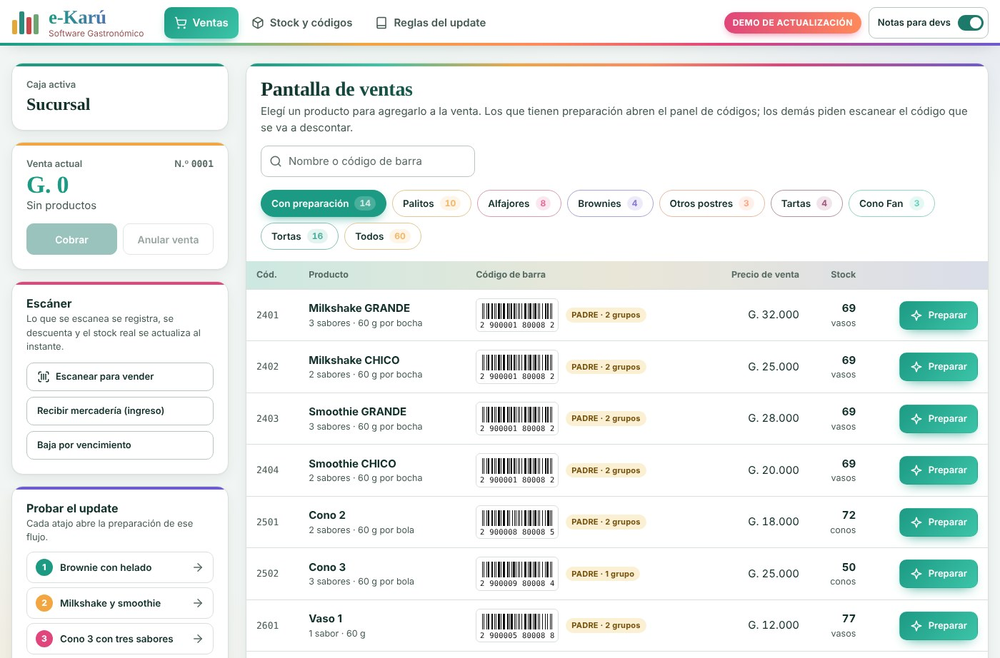
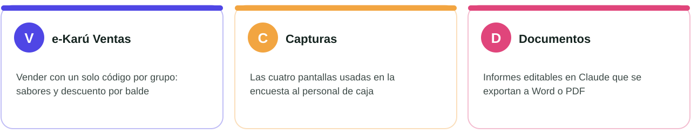
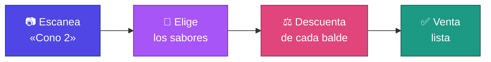
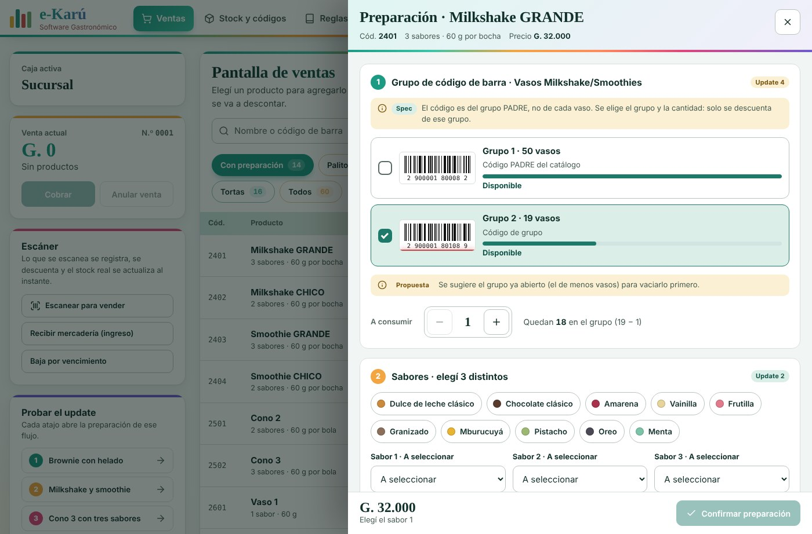
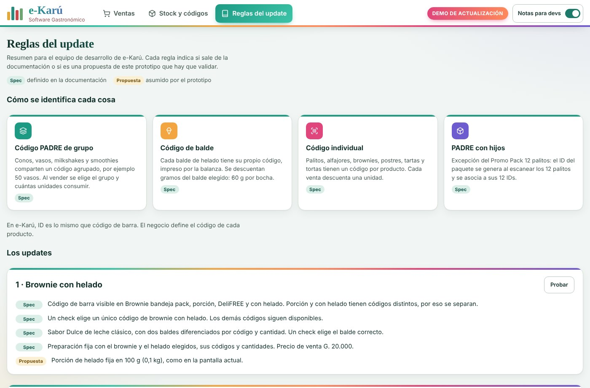

### 🛒 Una venta con código de grupo

## 🛒 e-Karú Ventas · [`ekaru-ventas/`](ekaru-ventas/)

Prototipo de la pantalla de ventas de e-Karú para mostrar a sus desarrolladores cómo vender con **un solo código por grupo** (por ejemplo «Cono 2» o «Milkshake grande»): la cajera escanea el código del grupo, elige los sabores y e-Karú descuenta de cada balde.

- `index.html`: versión actual (grupos PADRE, Promo Pack, brownies, stock por balde, reglas del update).
- `v1-codigo-grupal.html`: primera versión.

 

## 📸 Capturas e-Karú · [`capturas-ekaru/`](capturas-ekaru/)

Las cuatro capturas que se usaron en la encuesta al personal de caja (Cono 2, baldes, brownie con helado, brownie porción).

## 📚 Documentos (en Claude)

> [!TIP]
> Se editan en Claude y desde ahí se exportan a Word o PDF.

| Documento | Enlace |
|---|---|
| Allo Beirut · documentación final del sitio de pedidos en línea (Introducción a las Tecnologías Web, UPA) | [abrir](https://claude.ai/artifact/AZLrfg25iaLGeSrW1iSPMB) |
| Glacé Compras · del comprobante al stock en e-Karú | [abrir](https://claude.ai/artifact/AjexsZGJJxgToiKTKTkYqD) |
| Glacé Compras · informe para el equipo de e-Karú | [abrir](https://claude.ai/artifact/Xa5gBd5Zv1o2W3RAT1TtTE) |
| Resultados de la encuesta al personal de caja | [abrir](https://claude.ai/artifact/FB3KUnrFhdxE5xfrKYFBDa) |
| e-Karú Etiquetas · software y objetivo | [abrir](https://claude.ai/artifact/WXu5jWVefaMpg2yrPF1QLj) |
| e-Karú Ventas · código de barra grupal (diseño) | [abrir](https://claude.ai/artifact/92JNnU8CqEMLwBVmTC3Emz) |

Parte de: [ekaru-procesos](https://github.com/alvaroliuzzi-bot/ekaru-procesos) · [ekaru-etiquetas](https://github.com/alvaroliuzzi-bot/ekaru-etiquetas) · [glace-compras](https://github.com/alvaroliuzzi-bot/glace-compras)

